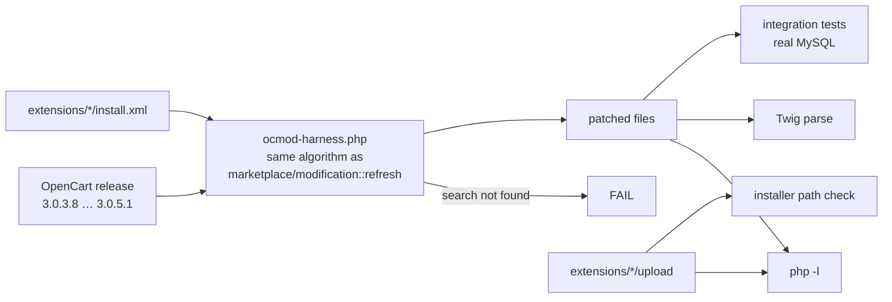

# OpenCart Extension Collection

Thirteen OpenCart 3 extensions for order handling, SEO structured data, catalog search and inventory reporting, built for and used on a production store. Every extension is checked against four official OpenCart releases with an OCMOD harness that reproduces OpenCart's own patch engine, and against MySQL with model-level integration tests.

[](https://github.com/shijinb/opencart-extension-collection/actions/workflows/ci.yml)


**Quick start:** `scripts/build.sh` → upload `dist/<extension>.ocmod.zip` in **Extensions → Installer** → **Extensions → Modifications → Refresh**.

## Contents

- [Extensions](#extensions)
- [Compatibility](#compatibility)
- [Installation](#installation)
- [Testing](#testing)
- [How the OCMOD harness works](#how-the-ocmod-harness-works)
- [Repository layout](#repository-layout)
- [Security review](#security-review)
- [Status and licence](#status-and-licence)

## Extensions

| Extension | What it does | Area | Version |
|---|---|---|---|
| [schema-json-ld](extensions/schema-json-ld/) | Product, Offer, Review, BreadcrumbList and Organization JSON-LD from real store data | SEO | 2.0.0 |
| [product-category-breadcrumbs](extensions/product-category-breadcrumbs/) | Full category trail on product pages opened without `?path=` | SEO / UX | 2.0.0 |
| [search-only-product-tags](extensions/search-only-product-tags/) | Keywords that make a product searchable without being displayed | Search | 2.0.0 |
| [product-phrase-search](extensions/product-phrase-search/) | Storefront search matches the phrase as typed | Search | 1.2.0 |
| [stock-report](extensions/stock-report/) | Inventory report per product/option with low-stock filter and CSV export | Reporting | 2.0.0 |
| [order-quick-save](extensions/order-quick-save/) | Save customer / payment / shipping details of an order without the full edit flow | Orders | 1.1.0 |
| [order-prev-next-navigation](extensions/order-prev-next-navigation/) | Previous/next order buttons and status header on the order page | Orders | 1.1.0 |
| [order-filter-marketing-code](extensions/order-filter-marketing-code/) | Filter orders by marketing tracking code | Orders | 1.1.0 |
| [order-filter-telephone](extensions/order-filter-telephone/) | Filter orders by telephone | Orders | 1.1.0 |
| [product-storefront-link](extensions/product-storefront-link/) | Product form title links to the live product page | Admin UX | 1.2.0 |
| [google-shopping-sku-as-gtin](extensions/google-shopping-sku-as-gtin/) | Send numeric GTIN-format SKUs as GTIN to Google Shopping | Feeds | 1.1.0 |
| [cart-expiry-extension](extensions/cart-expiry-extension/) | Keep guest carts for 7 days instead of 1 hour | Checkout | 1.1.0 |
| [customer-online-forwarded-ip](extensions/customer-online-forwarded-ip/) | Real client IP in *Customers Online* behind a proxy | Reporting | 1.1.0 |

Each extension's README covers its behaviour, the files it modifies, install and uninstall steps, limitations, and **what changed from the original version** and why.

## Compatibility

| OpenCart | OCMOD harness (patch + lint) | Integration tests (MySQL) |
|---|---|---|
| 3.0.3.8 | ✔ all 13 | ✔ |
| 3.0.3.9 | ✔ all 13 | ✔ |
| 3.0.4.1 | ✔ all 13 | ✔ |
| 3.0.5.1 | ✔ all 13 | ✔ |

- **Themes:** template operations target the default theme's markup. `catalog/view/theme/*/` paths also patch custom themes, but only where their markup matches. Check **Extensions → Modifications → Log** after refreshing.
- **OpenCart 2.x / 4.x:** not supported. OpenCart 4 replaced OCMOD with events.
- **PHP:** targets PHP 7.3 and newer. Older PHP versions that OpenCart 3.0.3.x itself still runs on are not targeted. CI runs PHP 7.4 (OpenCart 3.0.3.8 and 3.0.3.9), 8.1 (3.0.4.1) and 8.3 (3.0.5.1); PHP 7.3 itself is not tested.

## Installation

```bash
scripts/build.sh            # creates dist/<extension>.ocmod.zip for every extension
```

1. **Extensions → Installer** → upload the `.ocmod.zip`.
2. **Extensions → Modifications** → **Refresh**.
3. Extension-specific steps (run them before refreshing):
   - `search-only-product-tags`: run `install.sql` first.
   - `stock-report`: install and enable it under **Extensions → Extensions → Reports**.

**Before installing on a live store,** take a backup and try the package on a staging copy. OCMOD changes core files at runtime, and other installed modifications can conflict.

## Testing

```bash
composer install                     # Twig, used only to parse modified templates
tests/run.sh                         # harness on 4 OpenCart versions + unit tests
DB_HOST=127.0.0.1 DB_PORT=3306 DB_USER=root DB_PASSWORD=secret tests/run.sh   # + MySQL integration tests
OC_VERSIONS=3.0.5.1 tests/run.sh     # a single version
```

`tests/run.sh` downloads the official OpenCart release archives from GitHub into `.cache/` on first use.

| Layer | What it checks | Where |
|---|---|---|
| OCMOD harness | Every `<search>` matches pristine core (no silently skipped operations), modified PHP passes `php -l`, modified Twig parses, `upload/` files are in installer-allowed directories | `tests/ocmod-harness.php` |
| Unit | JSON-LD builder: text cleanup, URLs, prices, availability, ratings, `</script>` escaping (29 checks) | `tests/unit/` |
| Integration | Patched models run through OpenCart's own `DB\MySQLi` driver against its install SQL plus synthetic fixtures: order filters, SQL-injection attempts, prev/next order, stock report rows and filters, phrase and tag search, category trail, rating summary (38 checks) | `tests/integration/` |

**Verified runs** (2026-10-25):

- Local: macOS, PHP 8.3.30, MySQL 8.4.9. Harness 0 errors / 0 warnings on all four versions; unit 29/29; integration 38/38 on each version.
- GitHub Actions (CI run #2): Ubuntu, MySQL 8.0, the full matrix above (PHP 7.4 / 8.1 / 8.3), all jobs passed.

**Not covered automatically:** controller and browser behaviour, such as the Quick Save AJAX flow, rendered admin pages and storefront output. These need a running store and should be checked manually; each extension's README says which.

### Regression evidence

The integration tests were also run against the **original** marketing-code filter (first commit). Against MySQL, the injection string `x' OR '1'='1` returned every order, and the order count query failed with `Unknown column 'o.tracking'`. Both cases are now tests.

## How the OCMOD harness works

OpenCart applies OCMOD modifications line by line: each `<search>` is trimmed and matched case-insensitively within a single line, `index` counts matches, and a missed search drops the remaining operations for that file unless `error="skip"` is set. A missed search is only visible in the modification log, so an extension can install "successfully" and half work. That is what happened with the original breadcrumb extension on OpenCart 3.0.5.1.



## Repository layout

```
extensions/<name>/
  install.xml            OCMOD modification (absent for stock-report)
  upload/                files copied by the installer (stock-report, schema-json-ld)
  install.sql            schema change (search-only-product-tags)
  README.md
tests/
  ocmod-harness.php      OCMOD engine + lint
  unit/                  plain-PHP unit tests
  integration/           MySQL fixtures, bootstrap, suites, run.sh
  run.sh                 entry point
scripts/build.sh         builds dist/*.ocmod.zip
.github/workflows/ci.yml OpenCart × PHP matrix with a MySQL service
```

## Security review

Review of every extension (2026-10-25):

| Finding (original versions) | Status |
|---|---|
| SQL injection in the marketing-code and telephone order filters (unescaped values) | Fixed, tested |
| SQL injection via `order_id` in previous/next navigation | Fixed (`(int)` cast), tested |
| Stock report bypassed the report access permission | Fixed (standard report extension) |
| JSON-LD printed without `JSON_HEX_TAG` inside `<script>` (XSS through product or review text) | Fixed, tested |
| Fabricated review ratings in structured data; hidden-text links | Removed |
| `X-Forwarded-For` trusted unconditionally | Documented; first address taken and validated |
| CSV export | Formula-injection prefixing added |

No credentials, API keys, customer data or production configuration are in this repository. See [SECURITY.md](SECURITY.md) to report a vulnerability.

## Status and licence

- **Ownership:** written by Shijin.
- **Licence:** [MIT](LICENSE). Free to use, modify and redistribute, including commercially, as long as the copyright notice is kept.
- **Not included:** an *external store / affiliate links* extension (pending an ownership check of bundled third-party code), and a third-party image-manager modification (not the author's work).

See [CHANGELOG.md](CHANGELOG.md) for the release history.
